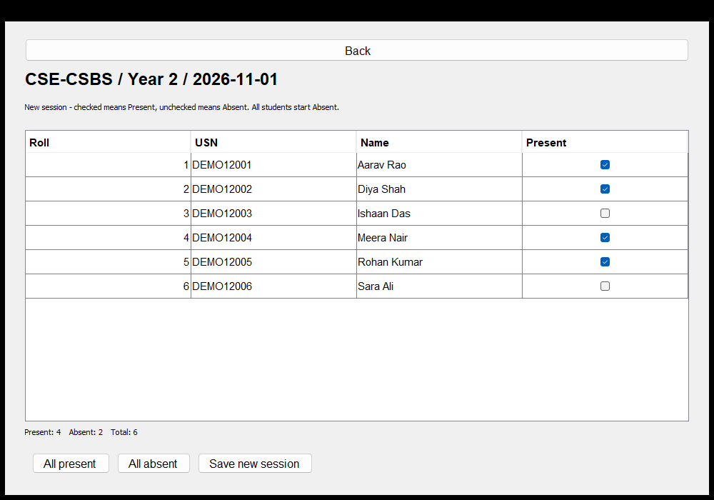

# Student Attendance Management System

A simple Java Swing mini project for III Semester OOP's using JAVA (25PCCSBS301), academic year 2026-27. The application is a desktop UI launched from the terminal. It uses **three application source files**, core Java only, and local text-file storage.



## Run

Install a **JDK 17 or newer** with both `java` and `javac` on PATH. A desktop display is required.

Windows: double-click **run.bat**, or run this from PowerShell in the project folder:

```powershell
.\run.bat
```

macOS / Linux:

```sh
sh run.sh
```

Manual commands, from this repository's root:

```text
javac --release 17 -encoding UTF-8 -d build src/attendance/*.java
java -cp build attendance.AttendanceApp
```

No Maven, database, browser, internet connection or external Java library is required. A JRE alone cannot compile the source. The code targets Java 17 and was compiled and tested with JDK 26.0.2 on Windows.

## Use the app

1. Choose **CSE-CSBS**, **CSE-General**, **CSE - PWC**, **CSE - Cybersecurity**, **Aerospace**, or **Mechanical**.
2. Choose **Year 1**, **Year 2**, **Year 3**, or **Year 4**.
3. **View students** lists students by roll number and searches names or USNs.
4. **Edit students** lets you add students or update a selected student's name and roll. USNs remain fixed after creation. Rolls must be unique within the course/year; USNs must be unique across the app.
5. **Take attendance (today)** opens checkboxes. Checked means present; unchecked means absent. Fresh sessions start all absent. Use **All present** or **All absent** as shortcuts, review the totals, then **Save new session** and confirm.
6. **View attendance** selects an existing date/session and opens a read-only roster.
7. **Edit attendance** selects an existing session and saves corrected checkboxes. It cannot create attendance for a missing date or change an existing session's date.

Every new attendance save creates a separate session, even on the same date. There is no subject-wise attendance. Yesterday's sample session is separate from any session you create today. The app uses the computer's local date.

## Demonstration data and storage

On first run, the app creates **144 fictional students**: six students in each of 24 course/year groups. Every group also gets one sample session dated the previous day, with four present and two absent. All sample USNs start with `DEMO`. Project team members are listed below; they are not mixed into fictional student records.

Data is saved after each successful change in `data/attendance.tsv`. Restarting the app reloads both students and attendance. Historical attendance keeps its original names and roll numbers, so later student edits do not rewrite the past. Students added later appear only in new attendance sessions.

The app validates data, writes a temporary snapshot before replacing the saved file, and rolls back in-memory changes if a save fails. A damaged file produces a startup error and is left untouched. Only one app instance may use a data directory at a time. Back navigation and window closing ask before discarding changed attendance checkboxes.

To reset your demo, close the app, **back up the whole `data` folder**, and rename that folder; the next launch creates a fresh demo. Keep backups if you use real records. You can use an independent data folder with:

```text
java -Dattendance.dataDir=demo-data -cp build attendance.AttendanceApp
```

The program is a single-computer teaching project. Login, subject-wise records, student deletion/transfer, automatic promotion, database storage and percentage reports are outside its current scope. Multiple sessions on one day are independent demonstrations, not a daily percentage calculation.

## Three source files

| File | Purpose |
| --- | --- |
| [Student.java](src/attendance/Student.java) | Abstract `Person`, immutable `Student`, constructors, getters and overridden description |
| [AttendanceBook.java](src/attendance/AttendanceBook.java) | Validation, searching, students, nested `Session`, demonstration data and UTF-8 persistence |
| [AttendanceApp.java](src/attendance/AttendanceApp.java) | Swing screens, buttons, forms, checkbox tables, navigation and startup |

Every nonblank line of the application source has an explanatory comment, including block endings. Read [the code walkthrough](docs/CODE_WALKTHROUGH.md) for the execution flow and [the syllabus mapping](docs/SYLLABUS_MAPPING.md) for exact examples of the circular's required concepts. Test files are separate from the three application files.

## Tests

```powershell
.\test.bat
.\test-ui.bat
```

On macOS/Linux, use `sh test.sh` for the data tests. For UI tests, compile with `sh test.sh`, then run `java -cp build attendance.AttendanceUiTest` in a desktop session. The UI test briefly displays the application and writes screenshots to `docs/screenshots/`.

Results: **41 data checks and 15 UI checks passed**. See [test results](docs/TEST_RESULTS.md). The tests use isolated temporary data and do not modify your `data/attendance.tsv`.

## Project team

| Name | USN |
| --- | --- |
| Ekta Patel | 25BTRCB020 |
| Shahan Samar | 25BTRCB044 |
| Akanksha Poovaiah M | 25BTRCB002 |
| Anany Mangal | 25BTRCB004 |
| Varsha Vakati | 25BTRCB055 |

Programme: B.Tech in Computer Science and Business Systems, JAIN (Deemed-to-be University). Course instructor: Dr. Santhosh Kumar S. No formal team leader has been designated.

## Report

The report in `report/Student_Attendance_Management_System_Report.docx` follows the supplied cover, certificate, declaration, acknowledgement, abstract, contents and 12-chapter report templates. It includes the design, diagrams, actual source listing, test evidence and real UI screenshots. Signatures and submission dates are left blank for the team and faculty. Guide and programme-head details are retained from the teacher's supplied templates and should be checked before submission.
